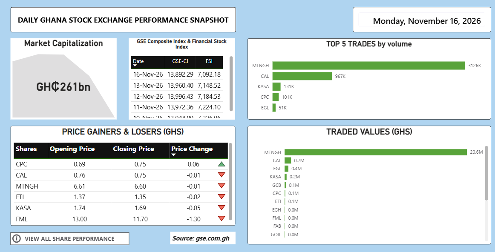

# GSE-Dashboard

## Live Dashboard
View the dashboard in near real-time: (https://app.powerbi.com/view?r=eyJrIjoiODQwNjY3NjUtMGRjMy00YzU3LWEwZmQtZDkzNTA2YjEwNTliIiwidCI6IjQyY2ZhZmVjLWI5NmItNDBmOS05MmFlLTdiMWU4MzM3YWI4MyJ9)

## Dashboard Overview
A quick high-level daily overview of stock performance on the Ghana Stock Exchange.

## Key Features
KPI and table visuals to display market capitalization, GSE Composite Index, and Financial Stock Index of the Exchange\
A table for Share price gainers and losers\
Bar charts to display top five trade volumes and traded share values.

## Tech Stack
Data Connectivity: web data accessed using Power BI\
Data Modeling: Power Bi Desktop and Power Query used to transform, analyze, and visualize data, Published in Power BI service\
Calculations: Calculated columns, Measures using DAX, time intelligence\
Data Visualizations: Cards, Clustered & Stacked bar charts, Tables, KPI\
Data Format: Optimized for web, desktop, and mobile views

## Data Source
Publicly available data from the Ghana Stock Exchange: https://gse.com.gh/trading-and-data/#dailyshares

## Dashboard Screenshot

